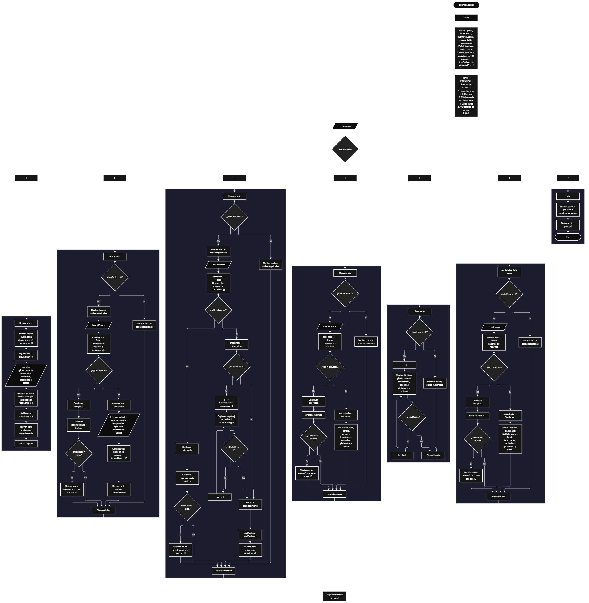

 

Este proyecto, llamado <b>álbum de series</b>, fue desarrollado en <b>PSeInt</b> como un ejercicio práctico para fortalecer la lógica de programación mediante la creación de un sistema de gestión de series desde la consola. El programa cuenta con un menú principal de siete opciones que permite <b>registrar, editar, eliminar, buscar, listar y consultar los detalles</b> de las series registradas, además de finalizar la ejecución del programa. Cada serie almacena información como el identificador, el título, el género, el director, la cantidad de temporadas, la cantidad de episodios, la plataforma y el estado. Para organizar estos datos se utilizan ocho arreglos relacionados, cada uno con una capacidad declarada de <b>100 posiciones</b>. Durante su desarrollo se aplicaron conceptos fundamentales de programación, como variables, arreglos, estructuras condicionales, ciclos repetitivos, estructuras de selección y variables lógicas. También se implementaron procedimientos para buscar, modificar, eliminar y mostrar registros. Este proyecto permite poner en práctica los conocimientos adquiridos en PSeInt y sirve como base para desarrollar sistemas de gestión más avanzados utilizando otros lenguajes y tecnologías.

<h2 align="center">⚙️ Funcionamiento del menú principal</h2>

### ➕ Registrar serie

La opción <b>1) registrar serie</b> permite agregar una nueva serie al álbum. Para comenzar, el programa utiliza la variable <b>siguienteID</b> para asignar un identificador consecutivo a la serie que se va a registrar. Este identificador se almacena en el arreglo <b>id</b>, en la posición siguiente a la cantidad de series registradas, y posteriormente se incrementa <b>siguienteID</b> en uno. Después, el programa solicita el <b>título, género, director, cantidad de temporadas, cantidad de episodios, plataforma y estado</b>. Cada dato se almacena en su arreglo correspondiente utilizando la misma posición para mantener relacionada toda la información de la serie. Una vez introducidos los datos, la variable <b>totalSeries</b> aumenta en uno y se muestra el mensaje <b>"serie registrada correctamente."</b>. El programa declara 100 posiciones para cada arreglo; sin embargo, actualmente no comprueba si se ha alcanzado la capacidad máxima antes de registrar una nueva serie.

### ✏️ Editar serie

La opción <b>2) editar serie</b> permite modificar la información de una serie previamente registrada. Primero, el programa comprueba si la variable <b>totalSeries</b> es igual a cero. Si no existen registros, muestra el mensaje <b>"no hay series registradas."</b>. En caso contrario, utiliza un ciclo <b>para</b> para recorrer las series almacenadas y mostrar sus datos, incluyendo el ID, el título, el género, el director, las temporadas, los episodios, la plataforma y el estado. Después, solicita el identificador de la serie que se desea editar y establece la variable lógica <b>encontrado</b> en <b>falso</b>. A continuación, recorre el arreglo <b>id</b> para comparar cada identificador con el valor introducido mediante la condición <b>id[i] = idBuscar</b>. Cuando encuentra una coincidencia, cambia <b>encontrado</b> a <b>verdadero</b> y solicita los nuevos valores de todos los campos de la serie. La información se actualiza directamente en los arreglos correspondientes, sin crear un registro adicional ni modificar el identificador de la serie. Finalmente, muestra el mensaje <b>"serie editada correctamente."</b>. Si termina la búsqueda sin encontrar el ID solicitado, presenta el mensaje <b>"no se encontró una serie con ese id."</b>.

### 🗑️ Eliminar serie

La opción <b>3) eliminar serie</b> permite eliminar una serie mediante su identificador. Antes de comenzar, el programa comprueba si existen registros utilizando la variable <b>totalSeries</b>. Si el álbum está vacío, muestra el mensaje <b>"no hay series registradas."</b>. De lo contrario, presenta una lista con los datos de las series disponibles y solicita el ID de la serie que se desea eliminar. Después, inicializa la variable lógica <b>encontrado</b> con el valor <b>falso</b> y recorre los identificadores hasta encontrar una coincidencia. Cuando encuentra la serie, cambia <b>encontrado</b> a <b>verdadero</b>. Si la posición seleccionada es anterior a la última posición ocupada, utiliza un ciclo <b>para</b>, controlado por la variable <b>j</b>, para desplazar una posición hacia la izquierda los datos de las series posteriores en los ocho arreglos: <b>id, titulo, genero, director, temporadas, episodios, plataforma y estado</b>. Este procedimiento permite mantener organizados los registros activos sin dejar espacios intermedios. Posteriormente, disminuye <b>totalSeries</b> en uno y muestra el mensaje <b>"serie eliminada correctamente."</b>. La posición que queda fuera del total actualizado no se limpia explícitamente, pero deja de formar parte de los registros activos. Si no se encuentra el identificador solicitado, el programa muestra el mensaje <b>"no se encontró una serie con ese id."</b>.

### 🔎 Buscar serie

La opción <b>4) buscar serie</b> permite localizar una serie mediante su identificador. Primero, el programa comprueba si existen series registradas. Si el álbum está vacío, presenta el mensaje <b>"no hay series registradas."</b>. En caso contrario, solicita el ID que se desea buscar e inicializa la variable lógica <b>encontrado</b> con el valor <b>falso</b>. A continuación, utiliza un ciclo <b>para</b> para recorrer los identificadores almacenados y compararlos con el valor introducido mediante la condición <b>id[i] = idBuscar</b>. Cuando encuentra una coincidencia, cambia la variable <b>encontrado</b> a <b>verdadero</b> y muestra todos los datos de la serie en una sola línea, incluyendo su identificador, título, género, director, temporadas, episodios, plataforma y estado. Si finaliza el recorrido sin encontrar coincidencias, muestra el mensaje <b>"no se encontró una serie con ese id."</b>. La búsqueda se realiza exclusivamente por el identificador de la serie, no por su título ni por otros campos.

### 📋 Listar series

La opción <b>5) listar series</b> permite visualizar todas las series registradas en el álbum. Antes de mostrar la información, el programa comprueba si la variable <b>totalSeries</b> es igual a cero. Si no existen registros, presenta el mensaje <b>"no hay series registradas."</b>. Si hay series disponibles, muestra el encabezado <b>"datos registrados"</b> y utiliza un ciclo <b>para</b> para recorrer los arreglos desde la primera posición hasta el total actual de series. Durante el recorrido, presenta el ID, el título, el género, el director, las temporadas, los episodios, la plataforma y el estado de cada registro. Esta función facilita consultar el contenido del álbum sin necesidad de buscar cada serie individualmente. Los registros se muestran en el orden en que se encuentran almacenados en los arreglos, sin aplicar una ordenación adicional.

### 📄 Ver detalles de la serie

La opción <b>6) ver detalles de la serie</b> permite consultar la información completa de una serie específica. Primero, el programa comprueba si existen series registradas. Si no hay datos disponibles, muestra el mensaje <b>"no hay series registradas."</b>. En caso contrario, solicita el identificador de la serie que se desea consultar e inicializa la variable <b>encontrado</b> con el valor <b>falso</b>. Después, recorre el arreglo <b>id</b> para buscar una coincidencia con el ID introducido. Cuando encuentra la serie, cambia la variable <b>encontrado</b> a <b>verdadero</b> y presenta la información detallada en líneas independientes: <b>ID, título, género, director, temporadas, episodios, plataforma y estado</b>. Esta presentación permite consultar cada dato de manera más clara que en la opción de búsqueda, donde todos los campos se muestran en una sola línea. Si no encuentra una serie con el identificador indicado, muestra el mensaje <b>"no se encontró una serie con ese id."</b>.

### 🚪 Salir del menú principal

La opción <b>7) salir</b> permite finalizar la ejecución del programa y muestra el mensaje <b>"gracias por utilizar el álbum de series."</b>. El menú principal se encuentra dentro de una estructura repetitiva <b>repetir ... hasta que</b>, que mantiene el programa en funcionamiento mientras el usuario realiza las operaciones disponibles. La condición de salida está definida mediante <b>Hasta Que opcion = 7</b>, por lo que, al seleccionar la opción 7, el ciclo termina después de ejecutar el mensaje de despedida. Si el usuario introduce un número que no corresponde a ninguna de las opciones disponibles, la estructura <b>Segun</b> ejecuta el bloque <b>De Otro Modo</b> y presenta el mensaje <b>"opción no válida."</b>.

<h2 align="center">🧠 Temas aplicados en el proyecto</h2>

### 📦 Variables

En este proyecto se utilizan variables para almacenar la opción seleccionada en el menú, controlar la cantidad de series registradas, asignar identificadores, recorrer los arreglos, guardar el ID que se desea buscar y comprobar si una serie fue encontrada. También se utilizan variables para representar los datos de cada serie, como el título, el género, el director, las temporadas, los episodios, la plataforma y el estado. Cada variable cumple una función específica dentro de las operaciones de gestión.

🔢 **Opcion:** Almacena la opción seleccionada por el usuario en el menú principal.

📊 **TotalSeries:** Almacena la cantidad actual de series registradas y determina cuántas posiciones de los arreglos se utilizan en las operaciones.

🆔 **SiguienteID:** Mantiene el próximo identificador que se asignará al registrar una serie nueva. Se incrementa después de cada registro.

🔎 **IDBuscar:** Almacena el identificador introducido por el usuario para buscar, editar, eliminar o consultar los detalles de una serie.

🔄 **I:** Funciona como contador en los ciclos que recorren las series y permite acceder a la posición correspondiente de cada arreglo.

🔁 **J:** Controla el ciclo que desplaza los datos de las series posteriores cuando se elimina un registro.

✅ **Encontrado:** Variable lógica que indica si se encontró una serie con el identificador solicitado. Se inicializa con el valor falso y cambia a verdadero cuando se localiza una coincidencia.

📝 **ID:** Representa los identificadores de las series almacenados en el arreglo correspondiente.

🎬 **Titulo:** Almacena los títulos de las series registradas.

🎭 **Genero:** Almacena los géneros de las series.

🎥 **Director:** Almacena los nombres o la información de los directores de las series.

📚 **Temporadas:** Almacena la cantidad de temporadas de cada serie.

📺 **Episodios:** Almacena la cantidad de episodios de cada serie.

🌐 **Plataforma:** Almacena la plataforma donde se encuentra cada serie.

📌 **Estado:** Almacena el estado de cada serie, por ejemplo, si está en emisión o finalizada, según el valor introducido por el usuario.

### 🗃️ Arreglos

En este proyecto se utilizan ocho arreglos relacionados para almacenar los datos de las series. Cada arreglo tiene una capacidad declarada de <b>100 posiciones</b> mediante la instrucción <b>dimension</b>. Todos utilizan el mismo índice para representar la información correspondiente a una misma serie. Por ejemplo, los datos de la serie almacenada en la posición <b>1</b> se encuentran distribuidos entre <b>id[1], titulo[1], genero[1], director[1], temporadas[1], episodios[1], plataforma[1] y estado[1]</b>. Esta organización permite recorrer, buscar, modificar, mostrar y eliminar registros manteniendo relacionados todos los campos de cada serie.

🆔 **ID[100]:** Almacena los identificadores de las series.

🎬 **Titulo[100]:** Almacena los títulos de las series.

🎭 **Genero[100]:** Almacena los géneros de las series.

🎥 **Director[100]:** Almacena los directores de las series.

📚 **Temporadas[100]:** Almacena la cantidad de temporadas de cada serie.

📺 **Episodios[100]:** Almacena la cantidad de episodios de cada serie.

🌐 **Plataforma[100]:** Almacena las plataformas de cada serie.

📌 **Estado[100]:** Almacena los estados de las series.

La variable <b>totalSeries</b> determina la cantidad de registros activos. Por este motivo, las operaciones de consulta recorren los arreglos desde la posición <b>1</b> hasta <b>totalSeries</b>. Aunque cada arreglo tiene 100 posiciones declaradas, el programa todavía necesita una validación para impedir que se intente registrar una serie cuando ya se han ocupado todas las posiciones disponibles.

### 🔀 Estructuras condicionales

En este proyecto se utilizan las estructuras <b>si</b> y <b>sino</b> para comprobar si existen series registradas antes de ejecutar las operaciones de edición, eliminación, búsqueda, listado y consulta de detalles. También se emplean para comprobar si una serie se encuentra en la posición seleccionada durante la eliminación y determinar si es necesario desplazar los registros posteriores. En las operaciones que buscan una serie por su identificador, la variable lógica <b>encontrado</b> permite determinar si se localizó una coincidencia. Estas condiciones permiten que el programa responda de manera diferente según la cantidad de registros disponibles y el resultado de cada búsqueda.

### 🔄 Estructuras repetitivas

En este proyecto se utilizan los ciclos <b>para</b> y <b>repetir ... hasta que</b>. Los ciclos <b>para</b> permiten recorrer los arreglos para mostrar las series, buscar identificadores y acceder a los registros que se desean modificar o consultar. Durante la eliminación, se utiliza otro ciclo <b>para</b>, controlado por la variable <b>j</b>, para desplazar los datos de las series posteriores una posición hacia la izquierda. Por otro lado, el ciclo <b>repetir ... hasta que</b> mantiene activo el menú principal y permite que el usuario realice diferentes operaciones hasta seleccionar la opción 7.

### 🎯 Estructura según

La estructura <b>segun</b> evalúa el valor almacenado en la variable <b>opcion</b> y ejecuta el bloque de instrucciones correspondiente. Cada caso representa una función del sistema: <b>1) registrar serie, 2) editar serie, 3) eliminar serie, 4) buscar serie, 5) listar series, 6) ver detalles de la serie y 7) salir</b>. También se incluye el bloque <b>de otro modo</b>, que muestra el mensaje <b>"opción no válida."</b> cuando el usuario introduce un valor que no corresponde a ninguna de las opciones definidas.

### 🔢 Dimensionamiento de arreglos

El programa utiliza la instrucción <b>dimension</b> para declarar ocho arreglos con 100 posiciones cada uno. Estos arreglos permiten almacenar la información correspondiente a un máximo previsto de <b>100 series</b>. La variable <b>totalSeries</b> controla cuántas posiciones contienen registros activos y se actualiza al registrar o eliminar una serie. Actualmente, el código no comprueba que <b>totalSeries</b> sea menor que 100 antes de registrar una nueva serie, por lo que la capacidad máxima todavía no está protegida mediante una validación.

### 🔄 Reorganización de registros

Cuando se elimina una serie, el programa comprueba si su posición es anterior a la última posición ocupada. Si es así, utiliza un ciclo <b>para</b> que comienza en la posición seleccionada y llega hasta <b>totalSeries - 1</b>. En cada repetición, los valores de la posición siguiente se copian sobre la posición actual en los ocho arreglos. De esta manera, la información de las series posteriores ocupa las posiciones disponibles sin dejar espacios intermedios en los registros activos. Finalmente, <b>totalSeries</b> disminuye en uno. La última posición utilizada no se borra expresamente, pero queda fuera del rango que el programa recorre mientras el contador se mantenga actualizado.

<h2 align="center">¿Cómo se implementaron las operaciones CRUD en el proyecto?</h2>

Las operaciones <b>CRUD</b> se implementaron mediante las opciones del menú principal, permitiendo administrar las series registradas en el álbum. La operación <b>crear (Create)</b> corresponde a <b>registrar serie</b>, donde se asigna un identificador y se introducen los datos de una nueva serie. La operación <b>leer (Read)</b> se realiza mediante las opciones <b>buscar serie, listar series y ver detalles de la serie</b>, que permiten localizar registros, consultar la colección y visualizar la información completa de una serie. La operación <b>actualizar (Update)</b> corresponde a <b>editar serie</b>, donde se modifican los datos de una serie existente sin cambiar su identificador. Por último, la operación <b>eliminar (Delete)</b> se realiza mediante <b>eliminar serie</b>, que retira un registro y reorganiza los datos posteriores en los arreglos. Estas operaciones utilizan variables, arreglos, condicionales y ciclos para gestionar la información almacenada temporalmente durante la ejecución del programa.

<h2 align="center">Diagrama de flujo del proyecto</h2>

El diagrama de flujo representa la estructura general del algoritmo <b>album_de_series</b>, desde la inicialización de las variables y la presentación del menú principal hasta la ejecución de cada una de sus siete opciones. También permite visualizar las decisiones que comprueban si existen registros, los recorridos de los arreglos, la búsqueda por identificador, la reorganización de los datos durante la eliminación y la condición que permite finalizar el programa. La imagen debe corresponder al diagrama de flujo elaborado para este proyecto y guardarse en el archivo <b>album_de_series.png</b> dentro de la misma carpeta que el README.

<h2 align="center">🛡️ Validaciones del programa</h2>

### 📭 No existen series registradas

Esta comprobación se utiliza en las opciones de <b>editar, eliminar, buscar, listar y ver detalles de la serie</b>. El programa evalúa si la variable <b>totalSeries</b> es igual a <b>0</b>. Si no existen registros, muestra el mensaje <b>"no hay series registradas."</b> y evita ejecutar las operaciones que necesitan información almacenada. Si hay series disponibles, permite continuar con el procedimiento correspondiente.

### ❌ Serie no encontrada

Esta validación se utiliza en las operaciones de <b>editar, eliminar, buscar y ver detalles de la serie</b>. Antes de recorrer los registros, el programa inicializa la variable lógica <b>encontrado</b> con el valor <b>falso</b>. Después, compara los identificadores almacenados en el arreglo <b>id</b> con el valor introducido en <b>idBuscar</b>. Cuando encuentra una coincidencia, establece <b>encontrado</b> en <b>verdadero</b> y ejecuta la operación solicitada. Si finaliza la búsqueda sin encontrar el identificador, muestra el mensaje <b>"no se encontró una serie con ese id."</b>. Esta validación permite informar al usuario cuando el ID introducido no corresponde a ninguna serie registrada.

### ⚠️ Capacidad máxima de los arreglos

Los ocho arreglos del programa tienen una capacidad declarada de <b>100 posiciones</b>. Sin embargo, el código actual no incorpora una condición que compruebe si <b>totalSeries</b> ha alcanzado el valor 100 antes de registrar otra serie. Por tanto, la capacidad máxima está definida en los arreglos, pero todavía no existe una validación que impida superar el límite. Para completar esta protección, sería necesario comprobar la disponibilidad de espacio antes de asignar el nuevo ID y solicitar los datos.

### 🔢 Identificadores de las series

El programa utiliza la variable <b>siguienteID</b> para asignar identificadores consecutivos a las series nuevas. Después de cada registro, esta variable aumenta en uno, por lo que eliminar una serie no provoca que su identificador se reutilice automáticamente. Además, durante las operaciones de edición, eliminación, búsqueda y consulta de detalles, se solicita el identificador de la serie para localizar el registro correspondiente. La asignación de identificadores se encuentra implementada, aunque el programa no incorpora una validación específica de entrada para comprobar que el usuario introduzca un número válido en cada lectura.

### ⚠️ Opción inválida

La estructura <b>segun</b> incluye el bloque <b>de otro modo</b>, que muestra el mensaje <b>"opción no válida."</b> cuando el usuario introduce un valor que no coincide con ninguna de las siete opciones del menú. La condición de salida del ciclo se establece mediante <b>Hasta Que opcion = 7</b>, de modo que seleccionar la opción 7 finaliza el programa después de mostrar el mensaje de despedida. Esta condición coincide con el número asignado a la opción de salida.

<h2 align="center">🎯 Objetivo del proyecto</h2>

El objetivo principal de este proyecto es fortalecer la <b>lógica de programación</b> mediante el desarrollo de un sistema de gestión de series en <b>PSeInt</b>. A través de su construcción se busca aplicar los conocimientos adquiridos sobre variables, arreglos, estructuras condicionales, ciclos repetitivos y estructuras de selección, integrándolos para resolver un problema de manera organizada. Además, el proyecto permite comprender cómo registrar, consultar, modificar y eliminar información mediante arreglos relacionados, asignar identificadores a los registros, buscar datos específicos y mantener organizada la información después de eliminar una serie. De esta manera, el álbum de series constituye una base para desarrollar aplicaciones de gestión más completas utilizando otros lenguajes de programación y tecnologías.

